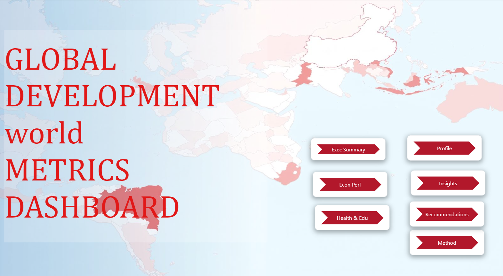
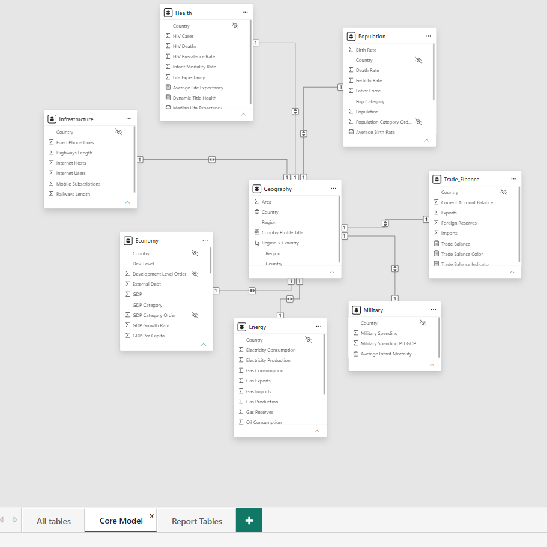
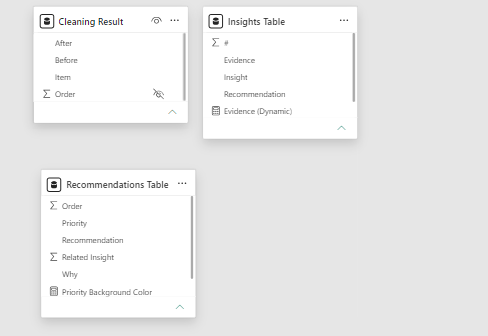
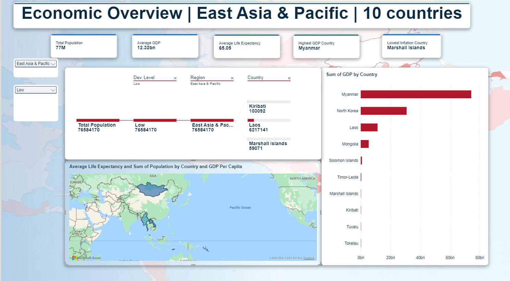
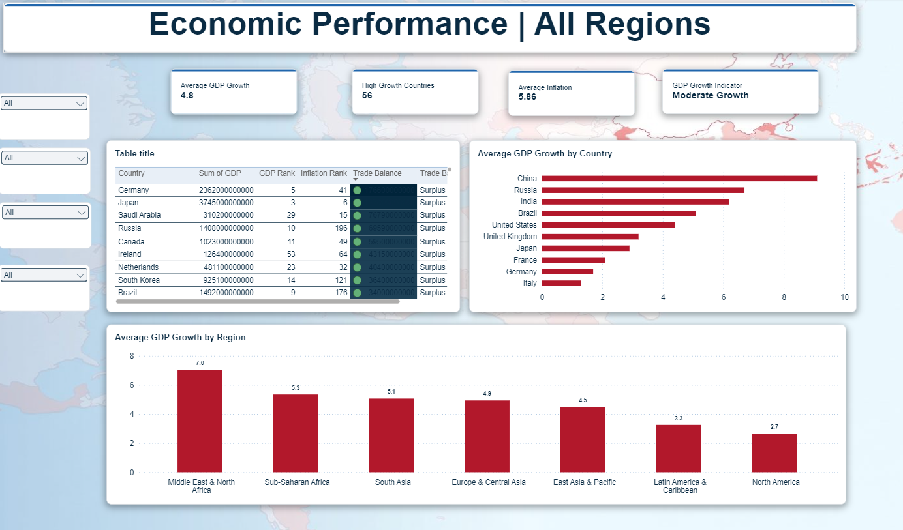
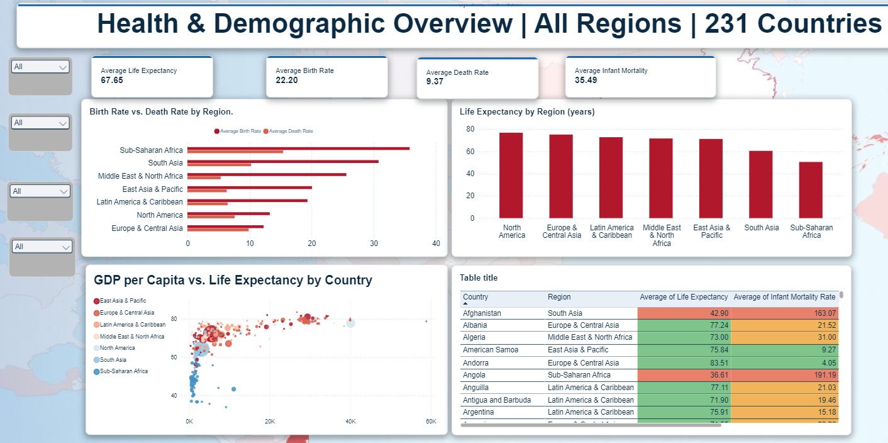
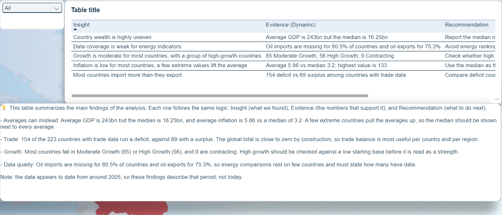
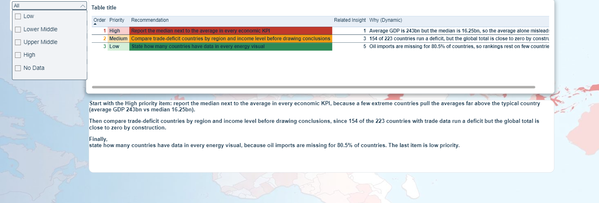
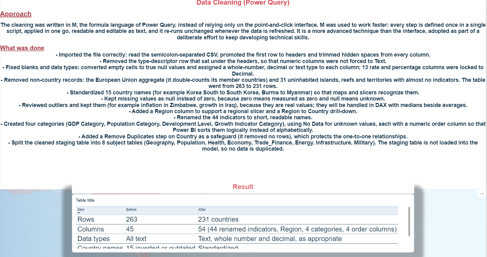

# Global Development World Metrics Dashboard (Power BI)

A 9-page Power BI report that compares 231 countries across economy, trade, population, health, energy, infrastructure and military indicators, with a written insights and recommendations layer on top of the visuals.

## Business question

How do countries compare on economic size, growth, inflation and trade, and which simple summary statistics give a misleading picture of "the typical country"?

## Data

| | |
|---|---|
| Source | Training project dataset provided through the DEPI program (Ministry of Communications and IT, Egypt) |
| File | `data/Country Data Comparison.csv` (semicolon-delimited) |
| Raw shape | 263 rows × 45 columns, all stored as text |
| Clean shape | 231 countries × 54 columns, split into 8 subject tables |

## Cleaning (Power Query M)

All cleaning is written in M in one staging query (`Stg_Country`), then referenced by the subject tables.

| Step | Before | After |
|---|---|---|
| Rows | 263 | 231 countries (removed the "European Union" aggregate and rows with fewer than 9 filled indicators; removed duplicate countries) |
| Data types | All text | Each column typed by scanning **all** its values: whole number, decimal or text |
| Country names | 15 inverted or outdated names (`Korea South`, `Burma`, `Swaziland`) | Standardized through a lookup record |
| Region | Not in the source | Added by joining a region list built in M |
| Categories | None | GDP, Population, Development Level and Growth categories, each with an order column for correct sorting |
| Column names | `GDP - real growth rate(%)` | `GDP Growth Rate` (44 indicators renamed) |

## Data model

- `Geography` (Country, Region, Area) is the hub.
- 7 subject tables, one row per country: `Population`, `Health`, `Economy`, `Trade_Finance`, `Energy`, `Infrastructure`, `Military`, each related to `Geography` on `Country` (1:1).
- 3 documentation tables built in DAX: `Insights Table`, `Recommendations Table`, `Cleaning Result`.
- 35 DAX measures, including medians next to averages, `RANKX` rankings, trade balance and conditional-format colour measures.

## Report pages

Home · Executive Overview · Economic Performance · Health & Education · Country Tooltip · Country Profile · Insights · Recommendations · Methodology

## Screenshots

| Executive Overview | Economic Performance |
|---|---|
|  |  |
| **Health & Demographics** | **Insights** |
|  |  |
| **Recommendations** | **Methodology** |
|  |  |

## Key insights

| # | Insight | Evidence |
|---|---|---|
| 1 | Country wealth is highly uneven | Average GDP is 243bn, but the median is 16.25bn |
| 2 | A few extreme values lift average inflation | Average 5.86 vs median 3.2; Zimbabwe is at 133 |
| 3 | Most countries import more than they export | 154 deficit vs 69 surplus among 223 countries with trade data |
| 4 | Most countries grow moderately | 85 Moderate Growth, 56 High Growth, 9 Contracting |
| 5 | Energy data coverage is weak | Oil imports missing for 80.5% of countries, oil exports for 75.3% |

**Main recommendation:** report the median next to the average in every economic KPI, because the average alone describes almost no real country.

## Limitations

- Single snapshot: the data has no year column and appears to date from around 2005, so findings describe that period, not today.
- Energy indicators have low coverage, so energy rankings rest on few countries.
- Global trade balance is close to zero by construction, so the deficit count describes countries, not the world.

## How to open

1. Install Power BI Desktop and enable **Power BI Project (.pbip)** save option if prompted.
2. Open `Country Data Comparison.pbip`.
3. In Power Query, change the file path in `Stg_Country` to where you saved `data/Country Data Comparison.csv`, then refresh.

## Tools

Power BI Desktop · Power Query (M) · DAX · PBIP / TMDL format for version control

## Author

**Omar Saad Abu Al-Khair**, Data Analyst · [LinkedIn](https://www.linkedin.com/in/omar-abualkhair)
